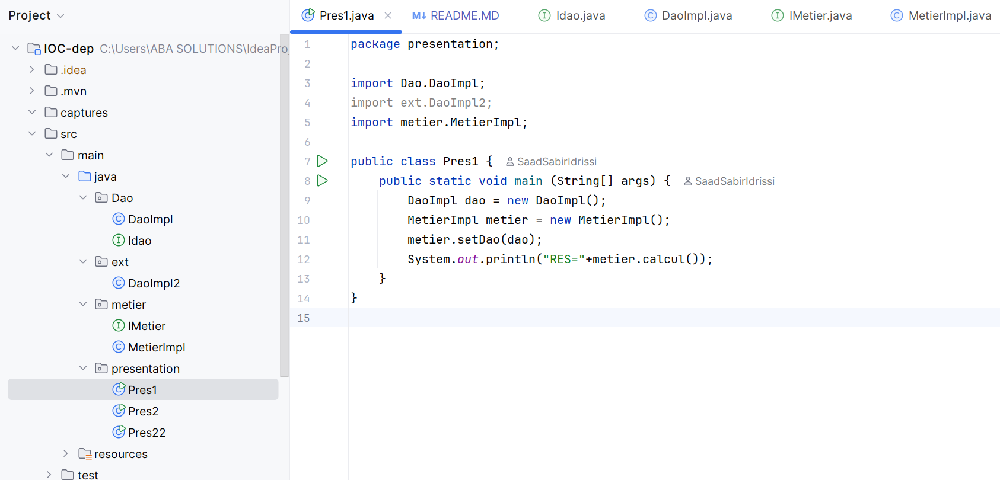
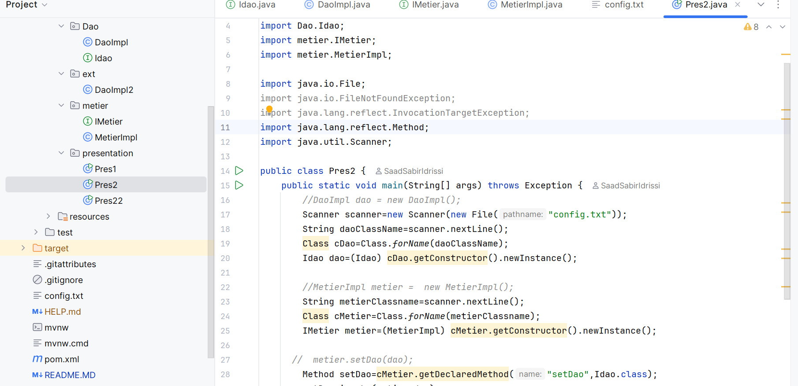
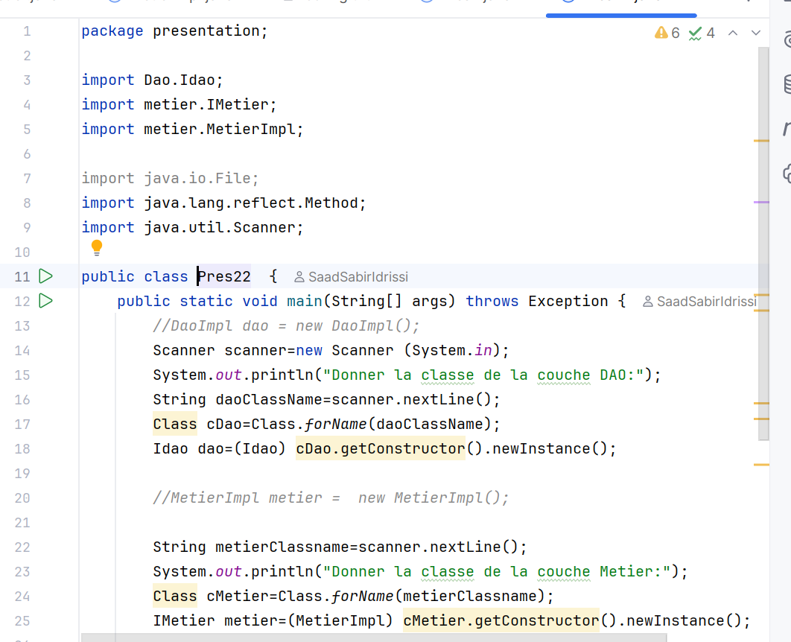

<h1>Compte rendu </h1>
<h2 style="font-weight: normal; font-size: 18px;">TP : Injection des dépendenses</h2>
<h3 style="font-weight: normal; font-size: 16px;">L'injection des dépendences avec l'instanciation statique :</h3>

<h3 style="font-weight: normal; font-size: 16px;">L'injection des dépendences avec l'instanciation dynamique :</h3>

<h3 style="font-weight: normal; font-size: 16px;">injecte le DAO dans le Métier pour ensuite calculer un résultat.:</h3>
