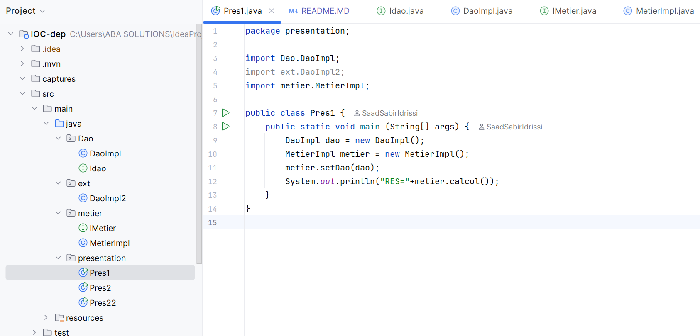
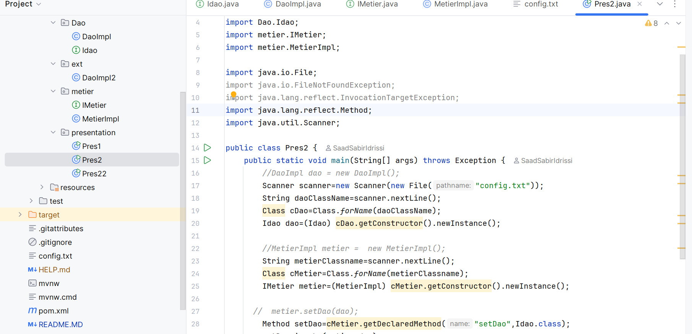

# 🔌 Injection de dépendances & Inversion de contrôle en Java

**Démonstration du couplage faible : une couche métier qui dépend d'une interface, et dont l'implémentation est choisie sans modifier le code.**


Travail pratique du module **Java / Spring** — Génie informatique, Université Mundiapolis.

---

## 🎯 Objectif

Montrer pourquoi on programme **contre des interfaces** et comment on passe d'un code fortement couplé à une application dont les dépendances sont injectées de l'extérieur. C'est le principe que Spring automatise ensuite avec son conteneur IoC.

## 🏗️ Architecture en couches

```
presentation  ──▶  metier (IMetier)  ──▶  dao (Idao)
                         │                    ├── DaoImpl    « version base de données »
                         └─ setDao(Idao)      └── DaoImpl2   « version web service »  (package ext)
```

- `Idao` / `IMetier` : contrats
- `MetierImpl` ne connaît que `Idao` : on peut changer de source de données sans le recompiler

## 🧪 Les trois versions de l'injection

| Classe | Technique | Ce qu'elle montre |
|---|---|---|
| `Pres1` | **Instanciation statique** (`new`) | L'injection se fait à la main, via le setter |
| `Pres2` | **Instanciation dynamique** (réflexion) | Les classes sont lues dans `config.txt` puis chargées avec `Class.forName` et `Method.invoke` : on change d'implémentation sans toucher au code |
| `Pres22` | Instanciation dynamique interactive | Même principe, mais les noms de classes sont saisis au clavier |

`config.txt` :

```
Dao.DaoImpl
metier.MetierImpl
```

Remplacer `Dao.DaoImpl` par `ext.DaoImpl2` suffit à passer à la « version web service ».

## 🚀 Exécuter

```bash
javac -d out $(find src/main/java -name "*.java")
java -cp out presentation.Pres1     # RES=387.6
java -cp out presentation.Pres2     # lit config.txt
```

Ou bien lancer `Pres1` / `Pres2` depuis IntelliJ IDEA.

## 📸 Captures

| Instanciation statique | Instanciation dynamique |
|---|---|
|  |  |

---

👤 **Saad Sabir Idrissi** — Élève ingénieur Data & IA · [Portfolio](https://saad-sabir-idrissi.vercel.app) · [LinkedIn](https://www.linkedin.com/in/saad-sabir-idrissi)
